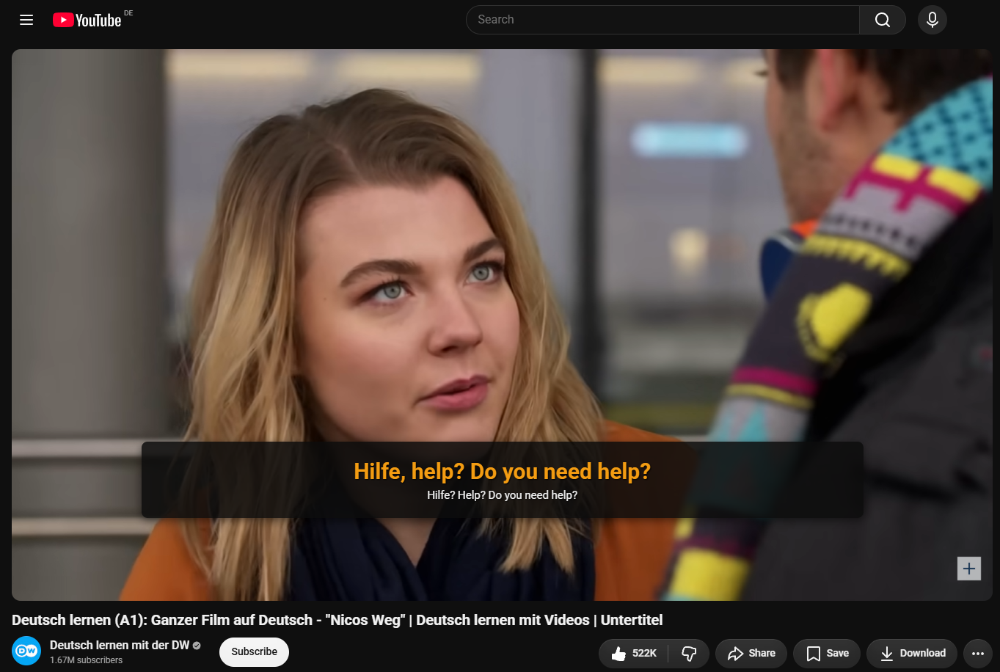
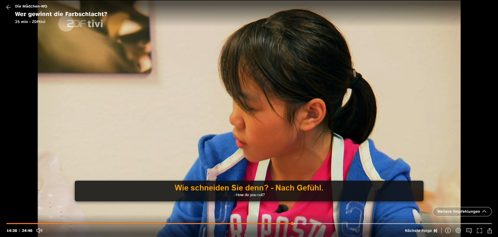
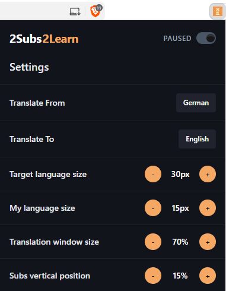
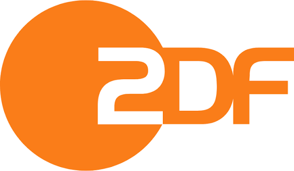

# 2Subs2Learn
## 1. What is this? Why was it developed?

  

**2Subs2Learn** is a powerful, lightweight browser extension designed to display dual subtitles on video streaming platforms. It was developed out of frustration with existing paid solutions (such as Intersub) that lock fundamental dual-subtitle features behind expensive subscriptions. 2Subs2Learn gives you complete freedom, utilizing custom translation servers to bridge language barriers seamlessly.

  

<p>







</p>

  

## 2. How it works

  

*  **Sliding-Window Batch Translation:** Subtitles are grouped into performance-optimized batches, pre-fetched, and cached locally.

*  **Smart Synchronization:** The video automatically syncs with custom dual-subtitle overlays. If the next translation batch is still loading, the video pauses smoothly and resumes instantly once translation finishes.

*  **API Translation Processing:** Subtitle translations are fetched via an external API server. Note that this self-hosted or default API can sometimes be slow and unreliable; if you want to host your own translation server to guarantee blazing-fast performance, you can find the complete server files inside the `translation-server` folder.

  

## 3. Supported Platforms

  

*  **YouTube**

*  **ZDF (`zdf.de`)**

  

*<!-- Add logos for YouTube and ZDF here or leave space to connect media files later -->*

<p>

 &nbsp;&nbsp;&nbsp;&nbsp; 
</p>

  

## 4. Supported Languages

  

*  **English ➔ German**

*  **German ➔ English**

*  *More language pairs coming soon!*

  

## 5. Customization Controls

  

2Subs2Learn features granular display controls to customize your learning experience:

*  **Subtitle Size:** Adjust the text font size for both source and target subtitles independently.

*  **Width:** Modify the text container width percentage to fit your screen style.

*  **Position:** Change the vertical position offset (`bottom` percentage) of the subtitle overlay box.

  

# [Download the latest release](https://github.com/alfazkhan/2Subs2Learn/releases/tag/0.0.4)

### For people who want to use it simple: 
**1. Download latest release and extract**
**2. Open Chrome/Brave Extensions**
**3. Turn on developer mode**
**4. Load unpacked select extracted folder** and start using.

  

## 6. How to make it work with your own local server (optional but recommended)

1.  **Clone the repository:**
    
      
    

Bash

```
git  clone [https://github.com/your-username/2Subs2Learn.git](https://github.com/your-username/2Subs2Learn.git)
cd  2Subs2Learn
```

2.  **Start the translation server:**
    
      
    

Bash

```

cd translation-server
npm install
node server.js
```

3.  **Load the extension into Chrome:**
    
      
    

-   Open Google Chrome and navigate to `chrome://extensions/`.
    
      
    
-   Enable **Developer mode** in the top-right corner.
    
      
    
-   Click **Load unpacked** and select the extension folder from your project directory.

  

## 7. Feedback & Contact

  

Got feedback or suggestions? Reach out here:

  

  

- Website / Contact: [theonlyalfaz.com](https://theonlyalfaz.com/)