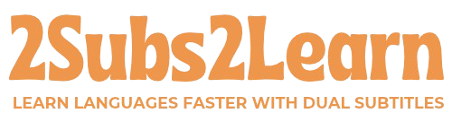
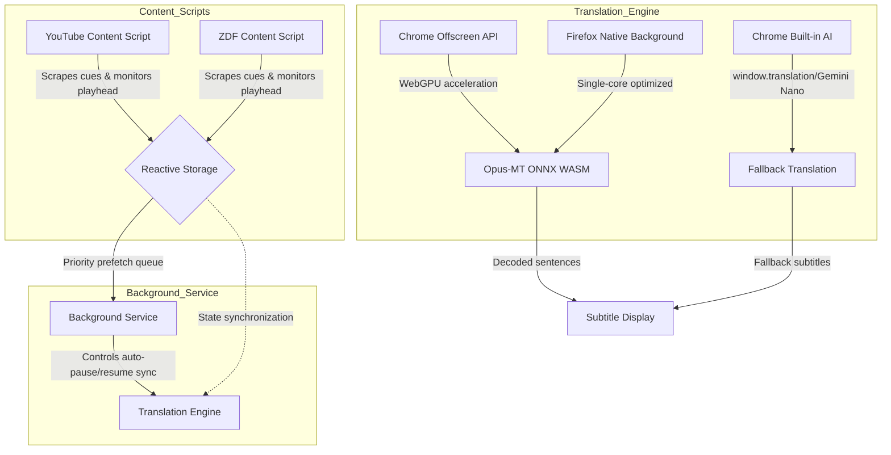

An advanced, cross-browser extension designed for language learners on **YouTube** and **ZDF**. Powered by client-side neural machine translation via Hugging Face Transformers.js and ONNX Runtime Web.

---

 

  <a href="#-key-features">Key Features</a> •
  <a href="#-architecture">Architecture</a> •
  <a href="#-supported-platforms--languages">Platforms & Languages</a> •
  <a href="#-usage--controls">Usage & Controls</a> •
  <a href="#-troubleshooting">Troubleshooting</a>

---

  
  &nbsp;&nbsp;
  
    
  
   
  <em>Dual subtitle overlays on YouTube & ZDF, featuring real-time customizable font sizing, offsets, and positioning.</em>

 

---

## ⚡ Key Features

- **100% In-Browser Machine Translation:** Powered by quantized Opus-MT models via `@xenova/transformers`. No third-party cloud translation APIs or external servers are required.
- **Zero Telemetry & Private by Design:** All subtitle parsing and neural inferences execute locally inside your browser sandbox. No video titles or captions ever leave your machine.
- **Sliding-Window Batch Prefetching:** Translates cues in small, pre-emptive chunks ahead of your current playback timestamp to ensure zero subtitle lag.
- **Smart Playback Auto-Sync:** Automatically holds playback state on uncached seek points while computing sentences, and automatically resumes once the target cue is decoded.
- **Robust Cross-Browser Engine:**
  - **Chromium (Chrome, Brave, Edge):** Uses the `chrome.offscreen` API with WebGPU acceleration and multithreaded WebAssembly workers, circumventing service worker limitations.
  - **Mozilla Firefox:** Native background execution running optimized single-core WASM routines without CSP or worker sandboxing conflicts.
- **Granular UI Styling:** Live adjust font sizes, container width, and vertical layout positions directly from the overlay or popup.

---

## 🏗️ Architecture

2Subs2Learn uses a client-side, reactive architecture that synchronizes subtitle translation across YouTube and ZDF platforms. The system prefetches subtitles ahead of playback using a sliding window approach, ensuring zero-latency subtitle display.

**Key Components:**
- **Content Scripts**: Scrape subtitle cues and monitor playback position on both platforms
- **Reactive Storage**: Synchronizes user preferences and translation state between scripts
- **Background Service**: Manages priority prefetch queue and controls auto-pause/resume behavior
- **Translation Engine**: Executes neural inference locally using WebGPU acceleration or native AI APIs
- **Subtitle Display**: Renders translated subtitles with customizable styling

---

## 📺 Supported Platforms & Languages

| Platform | Domain | Subtitle Format | Supported Status |
| :--- | :--- | :--- | :--- |
| **YouTube** | `youtube.com/watch` | Timed Text XML / JSON3 | ✅ Supported |
| **ZDF Mediathek** | `zdf.de/play` | TTML / EBU-STL XML | ✅ Supported |

 

&nbsp;&nbsp;&nbsp;&nbsp;&nbsp;&nbsp;&nbsp;&nbsp;&nbsp;&nbsp;&nbsp;&nbsp;&nbsp;&nbsp;&nbsp;&nbsp;

### Language Pairs
- 🇩🇪 **German $\rightarrow$ English** (`Xenova/opus-mt-de-en`)
- 🇬🇧 **English $\rightarrow$ German** (`Xenova/opus-mt-en-de`)
- *Additional model language pairs are scheduled for upcoming versions.*

---

## 🎛️ Usage & Controls

Once installed, 2Subs2Learn automatically detects playback on YouTube or ZDF.

- **Subtitle Font Sizing:** Change both target and source font sizes dynamically.
- **Vertical Offset:** Adjust the `bottom` percentage property to clear native player UI bars.
- **Container Sizing:** Limit or expand subtitle width from 30% to 100% of the player viewport.
- **Auto Pause Toggle:** Enable or disable smart auto-pausing during high-latency batch prefetching.

---

## 🤝 Feedback & Contributions

Issues, suggestions, and pull requests are welcome!

- **Website & Contact:** [theonlyalfaz.com](https://theonlyalfaz.com/)
- **Email:** [khanalfaaz14@gmail.com](mailto:khanalfaaz14@gmail.com)
- **Repository:** [github.com/alfazkhan/2Subs2Learn](https://github.com/alfazkhan/2Subs2Learn)
- **License:** [MIT](LICENSE)